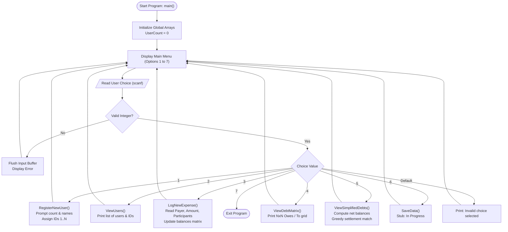

# 💸 SplitWise

> **A minimalist, console-based expense tracker and debt simplification tool written in C.**


---

## 📌 Table of Contents

- [About the Project](#about-the-project)
- [Academic Project Note](#academic-project-note)
- [Problem Statement](#problem-statement)
- [Objectives](#objectives)
- [Features](#features)
- [How It Works](#how-it-works)
- [Debt Matrix Explained](#debt-matrix-explained)
- [Technologies & Concepts Used](#technologies-and-concepts-used)
- [Project Structure](#project-structure)
- [Prerequisites](#prerequisites)
- [Installation & Compilation](#installation-and-compilation)
- [Usage Guide](#usage-guide)
- [Sample Expense Walkthrough](#sample-expense-walkthrough)
- [Data Storage & File Handling](#data-storage-and-file-handling)
- [Limitations](#limitations)
- [Future Improvements](#future-improvements)
- [What I Learned](#what-i-learned)
- [Contributing](#contributing)
- [License](#license)
- [Author & Acknowledgements](#author-and-acknowledgements)

---

<a id="about-the-project"></a>
## 📖 About the Project

**SplitWise** is a lightweight, command-line expense-sharing application built entirely in standard C. When roommates, friends, or travel companions share bills—such as groceries, rent, utilities, or restaurant tabs—tracking who paid what and calculating who owes whom quickly turns messy.

Instead of performing tedious manual arithmetic or dealing with chaotic multi-party money exchanges, **SplitWise** provides:
1. A structured in-memory registry of group members.
2. An expense logging mechanism that splits costs equally among chosen participants.
3. A transparent **$N \times N$ pairwise debt matrix** tracking every debt between individuals.
4. An automated **simplified settlement algorithm** that nets out mutual debts and suggests the minimum number of cash transfers required to settle all accounts.

---

<a id="academic-project-note"></a>
## 🎓 Academic Project Note

> [!NOTE]
> **Context:** This project was developed as a **first-semester lab project** for the **Software Development Fundamentals (SDF)** course while learning foundational C programming concepts.

It is intentionally designed as a foundational, educational console program. It does not aim to replace commercial financial software or enterprise-grade expense platforms. Rather, it demonstrates how fundamental programming concepts—arrays, multidimensional matrices, greedy settlement heuristics, string handling, pointers, and modular functions—can be applied to solve an intuitive, real-world coordination problem.

---

<a id="problem-statement"></a>
## 🧩 Problem Statement

In group living or travel environments:
- Multiple people pay for different group expenses at various times.
- Not everyone is involved in every shared expense.
- Debts often become reciprocal and cyclic (e.g., Alice owes Bob ₹100, Bob owes Charlie ₹100, and Charlie owes Alice ₹100).
- Calculating net settlements manually leads to confusion, redundant transactions, and bookkeeping errors.

**SplitWise** solves this problem by maintaining exact pairwise balance states in a 2D matrix and consolidating them into a clear net cash-flow settlement schedule.

---

<a id="objectives"></a>
## 🎯 Objectives

### Educational Goals
- Master **two-dimensional arrays** (`float balances[10][10]`) for relational tabular data.
- Practice **pass-by-reference semantics** in C using pointers (`int *UserCount`).
- Implement robust **console I/O and buffer sanitation** using `fgets()`, `strcspn()`, `scanf()`, and `getchar()`.
- Implement a **greedy cash-flow reduction algorithm** to consolidate debts.
- Structure procedural C code into cohesive, reusable functions.

### Functional Goals
- Allow dynamic registration of up to 10 users per session.
- Prevent duplicate participants and out-of-range user IDs when logging expenses.
- Divide shared bills equally across any subset of registered group members.
- Provide full visibility into direct debts through an easy-to-read tabular debt matrix.
- Generate step-by-step net settlement transactions so group members can square up easily.

---

<a id="features"></a>
## ✨ Features

The following table reflects the actual state of the codebase (`main.c`):

| Feature | Description | Status |
|---|---|:---:|
| **User Registration** | Register between 1 and 10 users with custom names (up to 49 chars). Assigns automatic sequential IDs (1 to 10). | ✅ **Implemented** |
| **View Registered Users** | Display an indexed directory of all currently active group members and their IDs. | ✅ **Implemented** |
| **Log Shared Expense** | Record an expense paid by any user, split equally among any chosen subset of participants with duplicate detection. | ✅ **Implemented** |
| **Two-Dimensional Debt Matrix** | Display an $N \times N$ formatted grid of pairwise debts (`Owes / To`). | ✅ **Implemented** |
| **Simplified Net Debts** | Calculate net balances for each person and use a greedy settlement loop to output minimal settlement payments. | ✅ **Implemented** |
| **Safe Input Sanitization** | Flush leftover newline characters from `stdin` to avoid skipped prompts during console input. | ✅ **Implemented** |
| **Persistent Data Storage** | Save user directory and ledger state to a disk file. | ⏳ **In Progress** (Stub) |
| **Load Data from File** | Restore previously saved user balances from disk on application startup. | 📋 **Planned** |
| **Custom / Unequal Splits** | Support exact amounts or percentage splits instead of strictly equal divisions. | 📋 **Planned** |
| **Multi-Currency Support** | Switch between different currency symbols (currently hardcoded to `Rs.`). | 📋 **Planned** |

---

<a id="how-it-works"></a>
## ⚙️ How It Works

The program operates as an interactive menu-driven console application. All application state is stored in global arrays and an active `UserCount` counter managed by `menu()`.

### Application Flowchart



---

<a id="debt-matrix-explained"></a>
## 🧮 Debt Matrix Explained

At the heart of the system is the two-dimensional array declared in `main.c`:

```c
float balances[10][10];
```

### 1. Matrix Convention

In the implementation, the indices represent:
- **Row index $i$** (`debtor`): The person who **owes** money.
- **Column index $j$** (`creditor`): The person to whom money is **owed**.

$$\text{balances}[i][j] = \text{Amount that User } (i+1) \text{ owes to User } (j+1)$$

When a user $P$ pays an expense of amount $A$ shared by $K$ participants:
$$\text{share} = \frac{A}{K}$$
For every participant $X \neq P$:
$$\text{balances}[X - 1][P - 1] \mathrel{+}= \text{share}$$

### 2. Concrete Example with 3 Friends

Suppose three friends register:
- **ID 1**: Alice
- **ID 2**: Bob
- **ID 3**: Charlie

#### Transaction 1: Alice pays ₹300 for groceries shared by Alice, Bob, and Charlie
- Total = ₹300, Participants = 3 (Alice, Bob, Charlie)
- Share per person = $\frac{300}{3} = \text{₹}100$
- Bob owes Alice ₹100 $\rightarrow \text{balances}[1][0] = 100.00$
- Charlie owes Alice ₹100 $\rightarrow \text{balances}[2][0] = 100.00$

#### Transaction 2: Bob pays ₹150 for snacks shared by Bob and Charlie
- Total = ₹150, Participants = 2 (Bob, Charlie)
- Share per person = $\frac{150}{2} = \text{₹}75$
- Charlie owes Bob ₹75 $\rightarrow \text{balances}[2][1] = 75.00$

#### The Resulting Direct Debt Matrix (`ViewDebtMatrix`):

| Owes / To | Alice (Col 1) | Bob (Col 2) | Charlie (Col 3) |
|---|---|---|---|
| **Alice (Row 1)** | `0.00` | `0.00` | `0.00` |
| **Bob (Row 2)** | `100.00` | `0.00` | `0.00` |
| **Charlie (Row 3)** | `100.00` | `75.00` | `0.00` |

### 3. Net Balance & Simplified Debt Settlement

Rather than making 3 separate payments (Bob $\rightarrow$ Alice ₹100, Charlie $\rightarrow$ Alice ₹100, Charlie $\rightarrow$ Bob ₹75), `ViewSimplifiedDebts()` computes the **net balance** for each person:

$$\text{net}[i] = \sum_{j=0}^{\text{UserCount}-1} \Big( \text{balances}[j][i] - \text{balances}[i][j] \Big)$$

- **Alice**: Received credits ₹(100 + 100) - debts ₹(0 + 0) = **+₹200.00** (Net Creditor)
- **Bob**: Received credits ₹(75) - debts ₹(100) = **-₹25.00** (Net Debtor)
- **Charlie**: Received credits ₹(0) - debts ₹(100 + 75) = **-₹175.00** (Net Debtor)

$$\sum \text{net}[i] = +200 - 25 - 175 = 0 \quad \text{(Conservation of Money)}$$

The algorithm iteratively pairs the largest net debtor with the largest net creditor using a greedy settlement:
1. **Charlie pays Alice ₹175.00** (Charlie’s balance becomes 0, Alice remains owed ₹25).
2. **Bob pays Alice ₹25.00** (Bob’s balance becomes 0, Alice’s balance becomes 0).

**Result:** All debts are settled in **2 simple transactions** instead of 3 pairwise debts!

---

<a id="technologies-and-concepts-used"></a>
## 🛠️ Technologies & Concepts Used

The project is implemented in pure ANSI C / C99 using only the standard library (`<stdio.h>`, `<stdlib.h>`, `<string.h>`).

| Concept | Implementation in Code |
|---|---|
| **Multidimensional Arrays** | `float balances[10][10]` stores pairwise debt relationships in tabular form. |
| **Parallel Arrays** | `userIDs[10]` and `userNames[10][50]` manage user identities alongside the matrix. |
| **Pointers & Pass-by-Reference** | `RegisterNewUser(int *UserCount)` modifies the caller's user counter in place. |
| **Console Buffer Sanitization** | `while (getchar() != '\n');` clears dangling newlines to prevent `fgets()` skipping. |
| **Safe String Manipulation** | `fgets()` prevents buffer overflow; `strcspn()` cleanly trims newline characters. |
| **Control Flow & Loops** | `do-while` menu loop, `switch-case` command dispatcher, and nested `for` matrix traversals. |
| **Greedy Heuristic Algorithm** | `ViewSimplifiedDebts()` resolves bilateral debts through repeated matching of extreme values. |
| **Floating-Point Precision Guard** | Uses an `epsilon = 0.005f` threshold to prevent infinite loops caused by IEEE 754 precision inaccuracies. |

> [!NOTE]
> **Educational Scope Note:** The current version utilizes fixed-size global arrays and parallel data structures. Advanced constructs like dynamic heap allocation (`malloc`/`free`), user-defined structures (`struct User`), and disk file streams (`fopen`/`fwrite`) are identified as upcoming milestones in the project roadmap.

---

<a id="project-structure"></a>
## 📁 Project Structure

```text
.
├── main.c        # Complete source code: menu, user management, matrix, and settlement logic
└── README.md     # Project overview, documentation, and technical explanation
```

### Function Breakdown in `main.c`

- **`RegisterNewUser(int *UserCount)`**: Prompts for the number of users to add, reads each name safely, checks limits, and populates `userIDs` and `userNames`.
- **`ViewUsers(int UserCount)`**: Prints a clean list of registered users and their corresponding IDs.
- **`LogNewExpense(int UserCount)`**: Prompts for payer ID, total amount, number of participants, and individual participant IDs; checks for duplicate entries; calculates shares; and increments `balances[participant-1][payer-1]`.
- **`ViewDebtMatrix(int UserCount)`**: Formats and prints the $N \times N$ grid of who owes whom.
- **`ViewSimplifiedDebts(int UserCount)`**: Computes net balances for all users and executes greedy debt consolidation.
- **`SaveData()`**: Current placeholder stub for file persistence.
- **`menu()`**: Runs the interactive `do-while` terminal loop and dispatches user actions.
- **`main()`**: Application entry point that initializes the program by calling `menu()`.

---

<a id="prerequisites"></a>
## 💻 Prerequisites

To compile and run SplitWise, you need:
- A standard C compiler:
  - **GCC** (GNU Compiler Collection) 4.8 or higher, or
  - **Clang** / Apple LLVM, or
  - **MSVC** (Microsoft Visual C++), or MinGW on Windows
- Standard C runtime library (`libc`)
- A terminal or command-line interface

Check if GCC or Clang is already installed on your machine:
```bash
gcc --version
# or
clang --version
```

---

<a id="installation-and-compilation"></a>
## 🚀 Installation & Compilation

### 1. Clone the Repository
```bash
git clone https://github.com/arnav1308/SplitWise.git
cd SplitWise
```

### 2. Compile the Source Code

#### On Linux / macOS (GCC or Clang):
```bash
gcc -Wall -Wextra -std=c99 main.c -o splitwise
```

#### On Windows (Command Prompt / PowerShell with MinGW GCC):
```cmd
gcc -Wall -Wextra -std=c99 main.c -o splitwise.exe
```

#### On Windows (Visual Studio Developer Command Prompt):
```cmd
cl /W4 main.c /Fe:splitwise.exe
```

### 3. Run the Program

#### On Linux / macOS:
```bash
./splitwise
```

#### On Windows:
```cmd
splitwise.exe
```

---

<a id="usage-guide"></a>
## 📖 Usage Guide

When launched, SplitWise presents a simple numeric menu:

```text
----------------- SplitWise -----------------
1. Register a new user.
2. View registered users.
3. Log a new expense.
4. View the debt matrix.
5. View simplified debts.
6. Save data.
7. Exit.
Enter your choice: 
```

### Menu Options Explained

| Option | Operation | Expected Input | Behavior |
|:---:|---|---|---|
| **1** | **Register a new user** | Number of users (1 to remaining slots), followed by each user's name | Adds users to registry, increments active count, displays assigned IDs. |
| **2** | **View registered users** | None | Prints list of registered names with their assigned IDs. |
| **3** | **Log a new expense** | Payer ID, Expense Amount, Participant Count, Participant IDs | Validates inputs, splits amount equally, updates debt matrix. |
| **4** | **View the debt matrix** | None | Prints a formatted table where Row = Debtor and Column = Creditor. |
| **5** | **View simplified debts** | None | Resolves reciprocal debts and prints minimal cash settlement instructions. |
| **6** | **Save data** | None | Placeholder function (prints progress message). |
| **7** | **Exit** | None | Terminates the program loop. |

---

<a id="sample-expense-walkthrough"></a>
## 🧪 Sample Expense Walkthrough

Here is an illustrative terminal walkthrough demonstrating how a shared dinner and cab ride are registered and resolved:

```text
----------------- SplitWise -----------------
1. Register a new user.
2. View registered users.
3. Log a new expense.
4. View the debt matrix.
5. View simplified debts.
6. Save data.
7. Exit.
Enter your choice: 1

Enter the number of users you wish to add (Max: 10): 3

Enter the name of user 1: Alice
User registered successfully! ID: 1, Name: Alice

Enter the name of user 2: Bob
User registered successfully! ID: 2, Name: Bob

Enter the name of user 3: Charlie
User registered successfully! ID: 3, Name: Charlie

----------------- SplitWise -----------------
Enter your choice: 3

------ Registered Users ------
ID: 1 | Name: Alice
ID: 2 | Name: Bob
ID: 3 | Name: Charlie
Enter the ID of the User who paid: 1
Enter the expense done: 300
How many people are sharing this expense (including payer): 3
Enter the user id of participant (1): 1
Enter the user id of participant (2): 2
Enter the user id of participant (3): 3
Each person's share is: 100.00

----------------- SplitWise -----------------
Enter your choice: 3

------ Registered Users ------
ID: 1 | Name: Alice
ID: 2 | Name: Bob
ID: 3 | Name: Charlie
Enter the ID of the User who paid: 2
Enter the expense done: 150
How many people are sharing this expense (including payer): 2
Enter the user id of participant (1): 2
Enter the user id of participant (2): 3
Each person's share is: 75.00

----------------- SplitWise -----------------
Enter your choice: 4

---------- SplitWise: Debt Matrix ----------

Owes / To      Alice       Bob         Charlie     
Alice          0.00        0.00        0.00        
Bob            100.00      0.00        0.00        
Charlie        100.00      75.00       0.00        

----------------- SplitWise -----------------
Enter your choice: 5

---------- SplitWise: Simplified Debts ----------

Charlie pays Alice: Rs. 175.00
Bob pays Alice: Rs. 25.00

----------------- SplitWise -----------------
Enter your choice: 7

Exiting SplitWise.
```

---

<a id="data-storage-and-file-handling"></a>
## 💾 Data Storage & File Handling

> [!WARNING]
> **Data Persistence Status:** File saving is currently under development.

In the current version of `main.c`, selecting option 6 triggers:

```c
void SaveData() {
    printf("File saving is in progress.\n");
}
```

### Current Behavior
- All registered users, expenses, and matrix balances are stored **exclusively in volatile RAM**.
- When the program is terminated (Option 7 or terminal close), **all session data is reset**.

### Planned Implementation
A future release will introduce a persistent file storage schema (e.g., `data.txt` or `splitwise.dat`) using standard C file I/O (`fopen`, `fprintf`, `fscanf`, `fclose`):
- Saving the active `UserCount`, `userNames`, and `balances[10][10]` matrix.
- Loading existing data automatically on startup if a save file is detected.

---

<a id="limitations"></a>
## ⚠️ Limitations

As a beginner-level academic project, SplitWise has specific known constraints:

1. **Fixed User Limit:** Limited to a maximum of 10 users due to static array dimensions (`balances[10][10]`).
2. **Volatile Memory:** Expenses reset upon program exit; persistent file storage is not yet active.
3. **Equal Splits Only:** Only supports dividing an expense equally among participants. Unequal shares, percentages, or custom itemized bills are not supported.
4. **Console-Only Interface:** Interaction is strictly command-line based; there is no web, graphical, or mobile interface.
5. **Single-User Local Runtime:** Intended to be run on one local terminal by one person at a time (no networking or multi-client support).
6. **Hardcoded Currency:** Currency displays exclusively in `Rs.` in simplified debt output.
7. **Basic Input Validation:** While numeric scans and buffer clearing are implemented, non-numeric entries during certain nested prompts may trigger validation aborts.

---

<a id="future-improvements"></a>
## 🔮 Future Improvements

- [ ] **Persistent File Storage:** Implement full file serialization (`SaveData`) and deserialization (`LoadData`) using `FILE *` I/O.
- [ ] **Data Structure Refactoring:** Migrate from parallel arrays to structured C types (`typedef struct { int id; char name[50]; } User;`).
- [ ] **Dynamic Memory Allocation:** Use `malloc()` and `realloc()` to support arbitrary numbers of users and transactions rather than fixing the limit at 10.
- [ ] **Unequal Expense Splits:** Support custom amounts and percentage-based shares.
- [ ] **Transaction Log & History:** Maintain a detailed log of past transactions (date, description, payer, amount).
- [ ] **Automated Unit Testing:** Add unit tests for the debt simplification heuristic and boundary validation.
- [ ] **Configurable Currency:** Allow the user to select their local currency symbol (`$`, `€`, `₹`, `£`).

---

<a id="what-i-learned"></a>
## 💡 What I Learned

Building this project provided hands-on experience with:

1. **Two-Dimensional Arrays:** Understanding row-major memory layout and using matrix coordinates $(i, j)$ to represent directional, pairwise relationships.
2. **Memory & Pointer Mechanics:** Passing variable addresses (`&UserCount`) to modify state across function scopes without relying exclusively on global return values.
3. **Input Stream Discipline:** Managing `stdin` quirks in C—specifically understanding why mixing `scanf()` and `fgets()` causes skipped inputs if trailing newline characters (`\n`) are not flushed.
4. **Algorithmic Thinking:** Formulating a greedy settlement algorithm to consolidate multi-party debts into minimal balance transfers.
5. **Defensive Programming:** Adding boundary conditions, upper limit checks, and duplicate participant filters to safeguard against out-of-bounds array access.

---

<a id="contributing"></a>
## 🤝 Contributing

Contributions, issues, and feature suggestions are welcome! Since this is an educational project, feedback on C programming best practices or code structure is especially appreciated.

1. **Fork the Repository**
2. **Create a Feature Branch**
   ```bash
   git checkout -b feature/AmazingFeature
   ```
3. **Commit Your Changes**
   ```bash
   git commit -m "Add feature: persistent file loading"
   ```
4. **Push to the Branch**
   ```bash
   git push origin feature/AmazingFeature
   ```
5. **Open a Pull Request**

---

<a id="license"></a>
## 📄 License

> [!NOTE]
> This project currently has **no specified open-source license**. All rights are reserved by the original author. If you wish to use, modify, or redistribute this code for educational or personal purposes, please contact the author for permission.

---

<a id="author-and-acknowledgements"></a>
## 👤 Author & Acknowledgements

- **Author:** Arnav
- **Course:** Software Development Fundamentals (SDF Lab Project)
- **Institution:** [Your College / University Name]

Special thanks to our course instructors and teaching assistants for guidance on foundational C programming and data structures.
